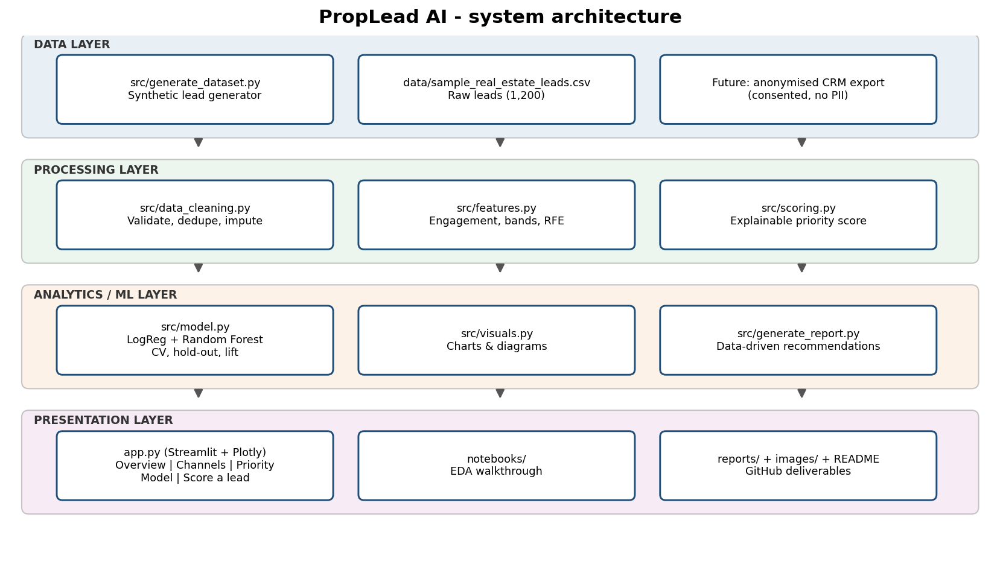
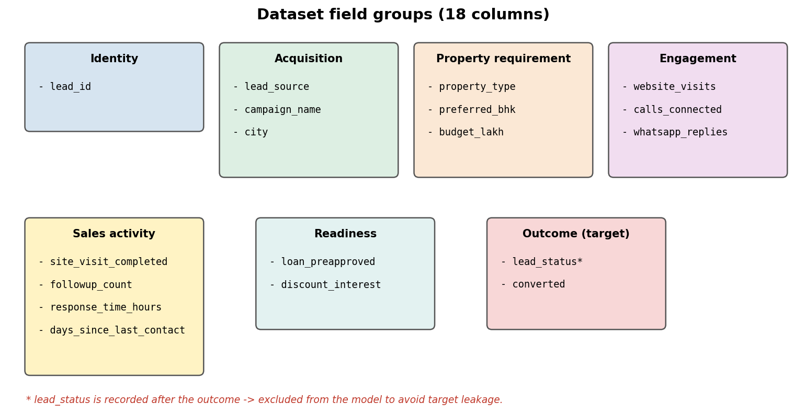
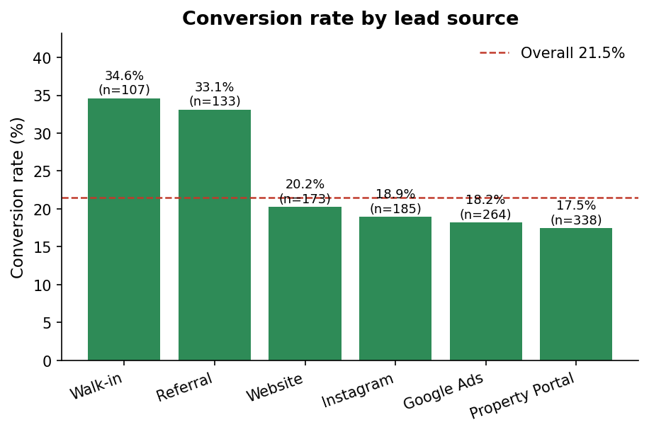
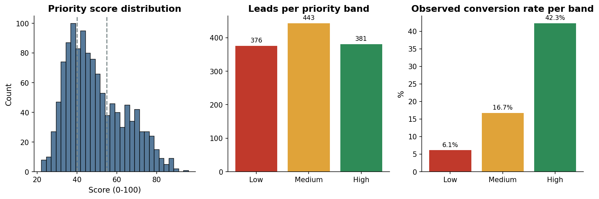
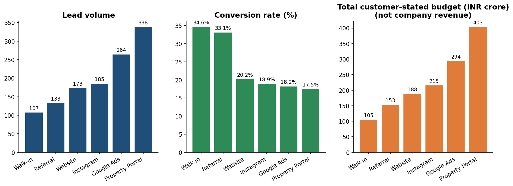
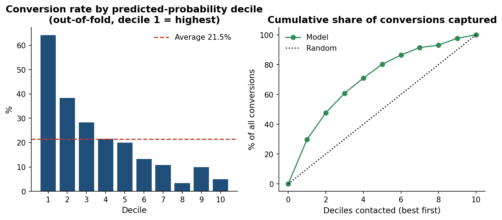
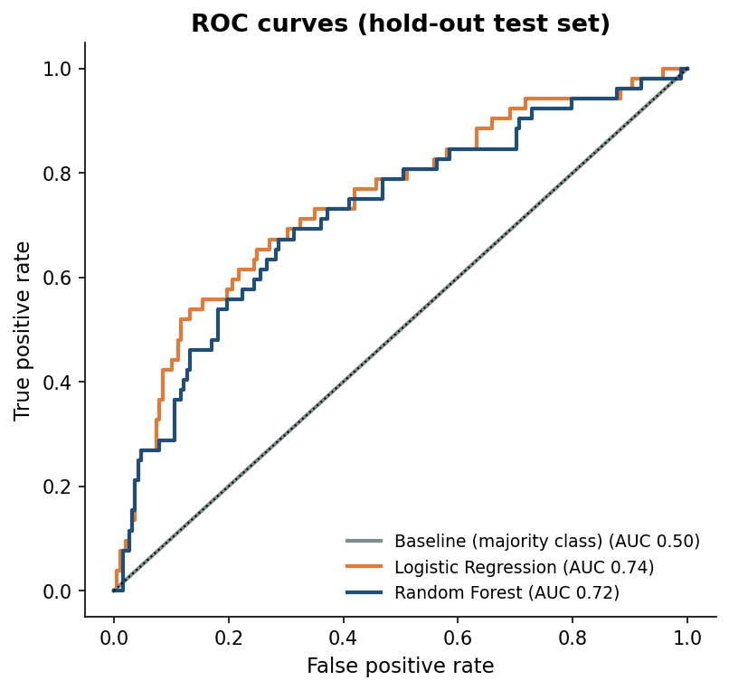
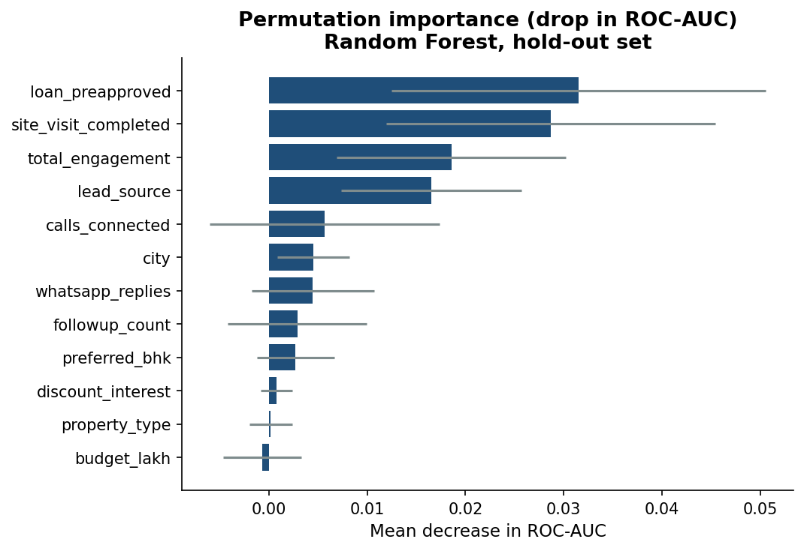
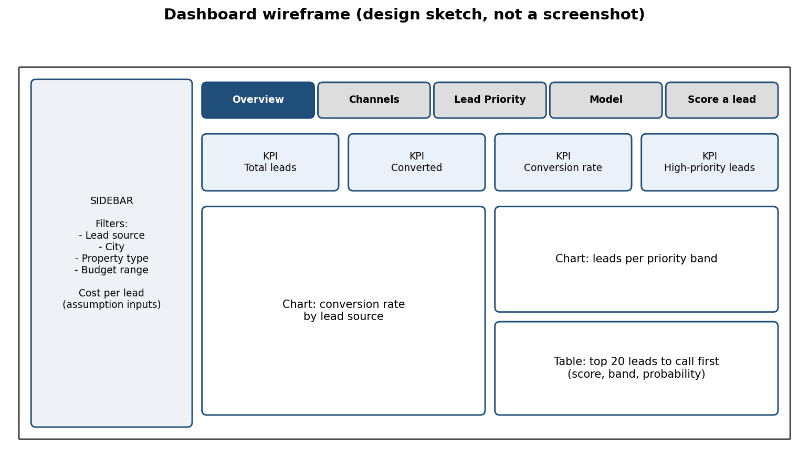

# 🏠 PropLead AI - Real Estate Lead Conversion Intelligence System

A data-driven **decision-support** framework for **lead prioritisation, conversion prediction and marketing-channel evaluation** in real estate.
*PGDM portfolio project - Marketing + Business Analytics.*

> ⚠️ **Data caveat:** the dataset in this repository is **synthetic** (1,200 generated records, no real customers).
> Results demonstrate the code and workflow only. They are **not** evidence of real real-estate market behaviour.
> The system supports sales staff; it does not guarantee sales or replace human judgement.

---

## 📌 Problem
Real-estate firms receive leads from property portals, Google Ads, Instagram, their website, referrals and walk-ins. Sales teams often treat every lead the same, even though leads differ in budget, intent, engagement, response time and readiness to visit a site. The result: delayed follow-ups, inefficient marketing spend and missed opportunities.

## 🎯 What this project does
| # | Capability | Module |
|---|---|---|
| 1 | Generates a documented synthetic lead dataset | `src/generate_dataset.py` |
| 2 | Cleans data (missing values, duplicates, inconsistent categories, outliers) | `src/data_cleaning.py` |
| 3 | Engineers engagement / follow-up features and a Recency-Frequency-Engagement (RFE) analysis | `src/features.py` |
| 4 | Computes an **explainable lead-priority score** (0-100; Low / Medium / High) | `src/scoring.py` |
| 5 | Trains and evaluates a baseline, Logistic Regression and Random Forest conversion model | `src/model.py` |
| 6 | Compares channels (volume, conversion, customer-stated budget) | `src/visuals.py` |
| 7 | Interactive **Streamlit dashboard** | `app.py` |
| 8 | Auto-generates a business-recommendation summary from real outputs | `src/generate_report.py` |


## 🧱 Architecture


## 📂 Repository structure
```
PropLead-AI/
├── app.py                          # Streamlit dashboard
├── run_pipeline.py                 # One command: data -> clean -> score -> model -> charts -> report
├── requirements.txt
├── README.md
├── LICENSE
├── data/
│   ├── sample_real_estate_leads.csv    # synthetic raw data (1,200 rows)
│   └── processed/                      # cleaned_leads.csv, scored_leads.csv
├── notebooks/
│   └── PropLead_AI_Analysis.ipynb      # EDA + feature engineering + modelling (with outputs)
├── src/
│   ├── config.py  generate_dataset.py  data_cleaning.py
│   ├── features.py  scoring.py  model.py
│   └── visuals.py  generate_report.py
├── images/                         # charts + diagrams used in this README
├── reports/                        # BUSINESS_RECOMMENDATIONS.md, metrics JSON, CSV summaries
├── models/                         # rf_conversion_model.joblib
├── docs/                           # REQUIREMENTS, DATA_DICTIONARY, METHODOLOGY, ETHICS, upload guide, original proposal
├── tests/                          # pytest sanity tests
└── scripts/build_notebook.py       # regenerates the notebook (optional)
```

## 🚀 Quick start
```bash
git clone https://github.com/<your-username>/PropLead-AI.git
cd PropLead-AI

python -m venv .venv
source .venv/bin/activate          # Windows: .venv\Scripts\activate
pip install -r requirements.txt

python run_pipeline.py             # regenerates processed data, model, charts and report (~20 s)
streamlit run app.py               # opens the dashboard at http://localhost:8501
```
Other commands:
```bash
python -m src.generate_dataset --rows 1200 --seed 42   # regenerate synthetic data
pytest -q                                              # run tests
jupyter notebook notebooks/PropLead_AI_Analysis.ipynb  # open the analysis notebook
```

## 🗃️ Dataset (synthetic)
18 columns in 7 groups - see [`docs/DATA_DICTIONARY.md`](docs/DATA_DICTIONARY.md).



| Field group | Variables |
|---|---|
| Identity (non-personal) | `lead_id` |
| Acquisition | `lead_source`, `campaign_name`, `city` |
| Property requirement | `property_type`, `preferred_bhk`, `budget_lakh` (customer-stated) |
| Engagement | `website_visits`, `calls_connected`, `whatsapp_replies` |
| Sales activity | `site_visit_completed`, `followup_count`, `response_time_hours`, `days_since_last_contact` |
| Readiness | `loan_preapproved`, `discount_interest` |
| Outcome | `lead_status` (leakage - excluded from model), `converted` (target) |

## 🔍 Selected results (from the synthetic data)
| Metric | Value |
|---|---|
| Leads / conversions | 1,200 / 258 (21.5%) |
| Conversion by priority band | High 42.3% · Medium 16.7% · Low 6.1% |
| Best / weakest source (conversion) | Walk-in 34.6% / Property Portal 17.5% |
| Random Forest (hold-out) | Precision 0.49 · Recall 0.46 · F1 0.48 · ROC-AUC 0.72 |
| Logistic Regression (hold-out) | Precision 0.44 · Recall 0.60 · F1 0.50 · ROC-AUC 0.74 |
| Baseline (majority class) | ROC-AUC 0.50 |
| 5-fold CV ROC-AUC (both models) | ≈ 0.78 |
| Top-30% of leads by model probability capture | ≈ 61% of conversions (out-of-fold) |

Both models beat the baseline; the hold-out set has only 240 leads, so the gap between Random Forest and Logistic Regression is within noise.
Full write-up: [`reports/BUSINESS_RECOMMENDATIONS.md`](reports/BUSINESS_RECOMMENDATIONS.md).

<table>
<tr>
<td></td>
<td></td>
</tr>
<tr>
<td></td>
<td></td>
</tr>
<tr>
<td></td>
<td></td>
</tr>
</table>

More charts are in [`images/`](images/) (missing values, budget distribution, city × property heat-map, response-time effect, correlation matrix, RFE segments, confusion matrix, model comparison).

## 🧮 Explainable priority score


`score = 30·engagement + 20·site_visit + 15·recency + 15·responsiveness + 10·loan_ready + 10·follow-up` → **High ≥ 55**, **Medium ≥ 40**, **Low < 40**.
Weights and thresholds are editable in [`src/config.py`](src/config.py). No sensitive personal attributes are used.

## 🖥️ Dashboard
Five tabs: **Overview** (KPIs, band and city charts) · **Channels** (volume, conversion, illustrative cost per conversion) · **Lead priority** (filterable call list, CSV download, per-lead score breakdown) · **Model** (metrics, confusion matrix, importance, lift) · **Score a lead** (what-if form).

Design sketch (wireframe, not a screenshot):


> 📸 *Tip: after running `streamlit run app.py`, take screenshots and save them as `images/dashboard_*.png`, then add them here.*

## ⚖️ Limitations, privacy and ethics
- Synthetic data → findings are illustrative only; validate on authorised, anonymised CRM data.
- Associations are not causal; scores are estimates for human review.
- Do **not** commit names, phone numbers, e-mails or exact addresses; never score with sensitive attributes.
- Leakage control: `lead_status`, `lead_id`, `converted`, `campaign_name` are excluded from the model.

Details: [`docs/LIMITATIONS_AND_ETHICS.md`](docs/LIMITATIONS_AND_ETHICS.md) · Requirements: [`docs/REQUIREMENTS.md`](docs/REQUIREMENTS.md) · Methodology: [`docs/METHODOLOGY.md`](docs/METHODOLOGY.md)

## 🔮 Future improvements
Validation on real anonymised CRM data · event timestamps and spend data · gradient boosting + calibration · SQL back-end · Power BI dashboard · A/B test of follow-up prioritisation · drift monitoring and sales-feedback loop.

## 🛠️ Tech stack
Python · Pandas · NumPy · Matplotlib · Seaborn · Scikit-learn · Plotly · Streamlit · Jupyter · Git/GitHub (optional: Excel, SQL, Power BI)

## 👤 Author
**<Your Name>** - PGDM (Marketing + Business Analytics), <Your Institute>
Contact: <your-email / LinkedIn>

## 📄 License
MIT - see [LICENSE](LICENSE).
