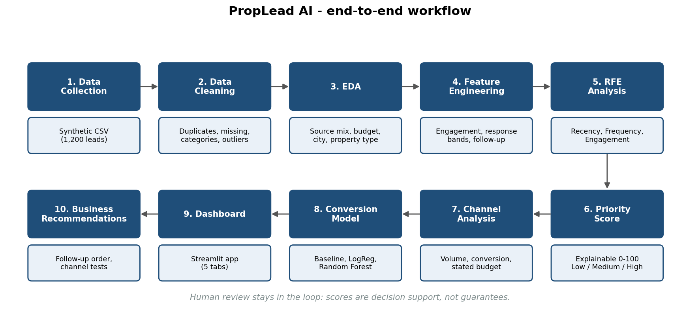
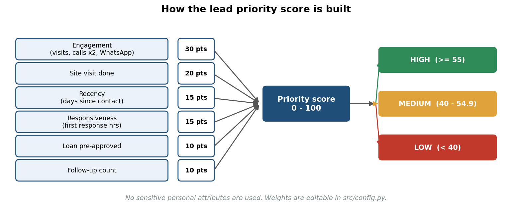

# Methodology

The ten workflow steps from the proposal and how each is implemented.


| # | Step | Implementation | Key decisions |
|---|---|---|---|
| 1 | Data collection | `src/generate_dataset.py` | Synthetic, seeded (42). A latent "intent" variable drives both engagement and conversion; a few quality issues are injected. |
| 2 | Cleaning | `src/data_cleaning.py` | Spelling standardisation via normalised keys; median imputation (by source / property type + city) with `*_imputed` flags; 99th-percentile capping. |
| 3 | EDA | notebook + `src/visuals.py` | Volume, conversion, budget, city x property, engagement, response time, correlations. |
| 4 | Feature engineering | `src/features.py` | `total_engagement`, bands, `readiness_level`. |
| 5 | RFE analysis | `src/features.py::add_rfm` | Recency/Frequency/Engagement quintile scores -> Cold/Cool/Warm/Hot. A lead-specific adaptation, not purchase RFM. |
| 6 | Segmentation / priority score | `src/scoring.py` | Rule-based weights, documented caps, three bands. |
| 7 | Channel & revenue-potential | `visuals.channel_summary` | Budget = customer-stated; no spend, so no ROI claim. |
| 8 | Strategic priority score | same as 6 | Uses only behavioural/readiness signals; no sensitive attributes. |
| 9 | Conversion model | `src/model.py` | Majority baseline, Logistic Regression, Random Forest; stratified 80/20 split; 5-fold CV; precision/recall/F1/ROC-AUC/PR-AUC; permutation importance; decile lift. |
| 10 | Recommendations | `src/generate_report.py` | Text generated from computed numbers; association language only. |

## Priority score


```
score = 30*engagement + 20*site_visit + 15*recency + 15*responsiveness + 10*loan_ready + 10*followup
engagement     = min(total_engagement / 25, 1)
recency        = 1 - min(days_since_last_contact / 60, 1)
responsiveness = 1 - min(response_time_hours / 48, 1)
followup       = min(followup_count / 6, 1)
site_visit, loan_ready = 0 or 1
```
Bands: **High >= 55**, **Medium >= 40**, **Low < 40**. Thresholds were chosen once by inspecting the demo score distribution
(roughly one-third of leads per band) and then frozen in `src/config.py`. Weights are expert-judgement defaults; with real data
they should be reviewed with sales managers and compared against observed outcomes.

## Why a rule-based score *and* a model?
| | Priority score | Conversion model |
|---|---|---|
| Nature | Transparent rules | Statistical estimate |
| Strength | Easy to explain and challenge | Learns interactions from data |
| Weakness | Weights are judgement-based | Needs labelled data; harder to explain |
| Use | Daily call ordering | Cross-check, probability estimate, lift analysis |

## Evaluation design and leakage control
* Stratified train/test split (80/20); metrics on hold-out; 5-fold CV on the training part.
* `lead_status` is excluded because it is written after the outcome.
* Probabilities shown in the dashboard are **out-of-fold**.
* Classification threshold 0.5 with class weights; a real deployment should choose the threshold from the cost of a missed lead vs. a wasted call.
* Hold-out has only 240 leads - treat small metric differences as noise.

## Known simplifications
* Imputation medians use the full table before splitting (about 2% missing; effect negligible here, but should be moved inside the CV pipeline for production).
* The score and the model use overlapping signals, so agreement between them is expected and is not independent confirmation.
* Because the data are synthetic, discovered relationships reflect the generator's assumptions.
